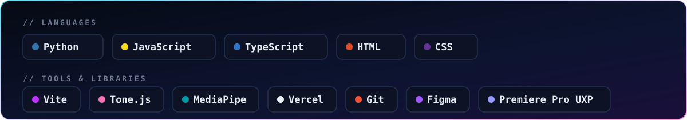

<p align="center">
  
</p>

<p align="center">
  <a href="https://aestheticdigitalfilm.vercel.app"></a>
  <a href="https://github.com/davidammielwan?tab=repositories"></a>
  
</p>


### `~/about`

```python
class David:
    major     = "Information Systems"
    building  = ["creative tools for audio + video", "web apps that ship"]
    exploring = ["agentic AI", "LLM-powered workflows"]
    currently = "turning side projects into things people actually use"
```

### `~/stack`



### `~/projects`

<table>
  <tr>
    <td width="50%" valign="top">
      <h4><a href="https://github.com/davidammielwan/beatsync">🎚️ BeatSync</a></h4>
      Beat-detection plugin for <b>Adobe Premiere Pro</b>. Analyses a clip's audio, previews beats on a colour-coded waveform, then drops real markers on each approved beat.
      <br/><br/><code>JavaScript</code> <code>UXP</code> <code>Audio DSP</code>
    </td>
    <td width="50%" valign="top">
      <h4><a href="https://github.com/davidammielwan/fingermusic">🖐️ fingermusic</a></h4>
      Play instruments with your hands through the webcam: hand tracking in the browser turns finger movement into music.
      <br/><br/><code>MediaPipe</code> <code>Tone.js</code> <code>Vite</code> · <a href="https://fingermusic-iota.vercel.app">live demo ↗</a>
    </td>
  </tr>
  <tr>
    <td width="50%" valign="top">
      <h4><a href="https://github.com/davidammielwan/SMU-LIT-Hackathon">⚖️ Amenda</a></h4>
      Regulatory change impact engine (SMU LIT Hackathon). Flags which client documents a new law makes wrong, why, and what to do, with a verbatim clause quote behind every flag.
      <br/><br/><code>Python</code> <code>FastAPI</code> <code>LLM</code>
    </td>
    <td width="50%" valign="top">
      <h4><a href="https://github.com/davidammielwan/BnbRadar">📡 BnbRadar</a></h4>
      Chrome extension that watches Airbnb listings for your dates and emails you on price drops and new availability. All data stays on your device.
      <br/><br/><code>Chrome Extension</code> <code>Gmail API</code>
    </td>
  </tr>
</table>

### `~/stats`

<p align="center">
  
  
</p>

<picture>
  <source media="(prefers-color-scheme: dark)" srcset="./profile/snake-dark.svg" />
  <source media="(prefers-color-scheme: light)" srcset="./profile/snake-light.svg" />
  
</picture>


<p align="center"><sub>stats regenerate every 12 hours via GitHub Actions · cards by <a href="https://github.com/stats-organization/github-readme-stats-action">github-readme-stats</a></sub></p>
